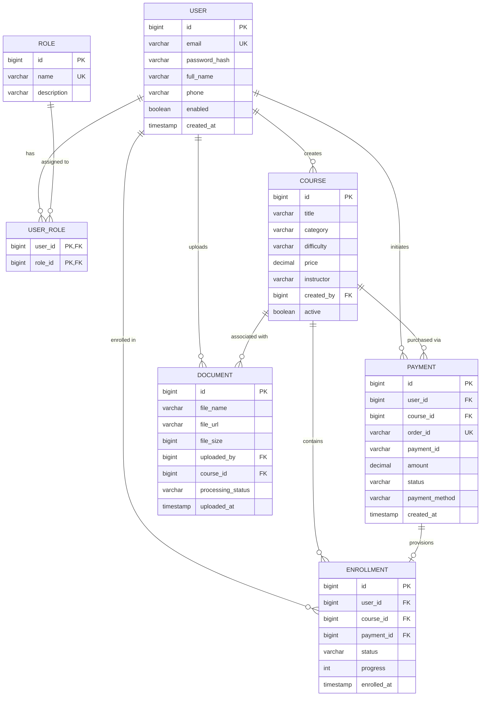

# A Mini Project Report
on
# SMART STUDENT LEARNING PORTAL

**Submitted in partial fulfillment of the requirements for the award of the degree of**  
**Bachelor of Technology in Computer Science & Engineering (Artificial Intelligence)**

---

### By
**[Project Team / Candidate Name]**  
Roll No: **[Candidate Roll Number]**

---

### Under the Guidance of
**Prof. Appasaheb Salunke**  
Assistant Professor  
Department of CSE (Artificial Intelligence)

---

### Department of Computer Science & Engineering (Artificial Intelligence)
**G H Raisoni College of Engineering & Management, Pune**  
*Accredited by NAAC with 'A+' Grade*  
*(An Empowered Autonomous Institute, Affiliated to Savitribai Phule Pune University, Pune)*  
**Academic Year 2026 – 2027 / June – Dec 2026**

\newpage

---

# Acknowledgements

We would like to express our deepest and most sincere gratitude to our esteemed project guide, **Prof. Appasaheb Salunke**, Assistant Professor, Department of Computer Science & Engineering (Artificial Intelligence), for his invaluable guidance, scholarly mentoring, continuous encouragement, and insightful feedback throughout the conceptualization, system architecture design, and empirical implementation of the project entitled **“Smart Student Learning Portal”**. His keen analytical perspectives, rigorous engineering standards, and consistent motivation played a pivotal role in resolving complex algorithmic, database design, and architectural challenges encountered during this research and development work.

We extend our heartfelt gratitude and respect to **Dr. Rachana Sable**, Head of the Department, Department of Computer Science & Engineering (Artificial Intelligence), for her visionary leadership, constant support, academic encouragement, and for providing a stimulating research atmosphere that fostered technical excellence and innovation.

We take this opportunity to express our profound gratitude to **Dr. N. B. Hulle**, I/C Director, G H Raisoni College of Engineering and Management, Pune, for granting us access to the institution’s high-performance laboratory computing facilities, academic digital libraries, and advanced research infrastructure necessary to bring this project to fruition.

We are deeply indebted to the esteemed **Management of G H Raisoni College of Engineering and Management, Pune**, for their steadfast commitment to promoting engineering innovations and cultivating an ecosystem that enables undergraduate engineers to construct production-ready software solutions.

We also wish to thank the **technical staff and laboratory attendants** of the Computer Science and Engineering Department for their prompt assistance, system maintenance, and network support during the benchmarking and testing phases of the application.

Finally, we express our profound appreciation to our **parents, family members, and peers** for their unwavering patience, emotional encouragement, and constant moral support during the intensive phases of this engineering endeavor.

---

# Contents

| Sr. No. | Topic | Page No. |
| :---: | :--- | :---: |
| | **Acknowledgement** | **i** |
| | **Contents** | **ii** |
| | **List of Tables** | **iii** |
| | **List of Figures** | **iv** |
| | **Abstract** | **v** |
| **Chapter-1** | **Introduction** | **1** |
| | 1.1 Overview & Motivation | 1 |
| | 1.2 Problem Statement | 2 |
| | 1.3 System Overview & Methodology | 3 |
| **Chapter-2** | **Scope & Limitation of Project** | **5** |
| | 2.1 Scope | 5 |
| | 2.2 Limitations | 6 |
| **Chapter-3** | **Software Requirement Specification** | **7** |
| | 3.1 Hardware Requirements | 7 |
| | 3.2 Software Requirements | 7 |
| | 3.3 Functional Requirements | 8 |
| | 3.4 Non-Functional Requirements | 9 |
| **Chapter-4** | **Entity-Relationship Diagram** | **11** |
| | 4.1 Entities and Attributes | 11 |
| | 4.2 Relationships | 12 |
| | 4.3 Entity-Relationship (ER) Model Diagram | 13 |
| **Chapter-5** | **ER to Table Conversion** | **14** |
| | 5.1 Conversion Rules | 14 |
| | 5.2 Resulting Relational Tables | 15 |
| **Chapter-6** | **Normalization upto 3NF** | **19** |
| | 6.1 First Normal Form (1NF) | 19 |
| | 6.2 Second Normal Form (2NF) | 20 |
| | 6.3 Third Normal Form (3NF) | 21 |
| | 6.4 Normalization Summary Matrix | 22 |
| **Chapter-7** | **Schema Diagram** | **23** |
| | 7.1 Relational Schema Architecture | 23 |
| | 7.2 Integrity Constraints & Cascade Specifications | 24 |
| **Chapter-8** | **Coding (Connectivity)** | **25** |
| | 8.1 Database Connection Configuration | 25 |
| | 8.2 Payment Processing & Automated Course Enrollment Service | 27 |
| | 8.3 Client-Side Course Retrieval & Sandbox Payment Invocation | 29 |
| **Chapter-9** | **Screen Shots** | **32** |
| | 9.1 Authentication, Student Dashboard and Profile Screens | 32 |
| | 9.2 Course Catalog, SmartPay Sandbox Modal, My Courses and Admin Screens | 34 |
| **Chapter-10** | **Future Scope** | **37** |
| **Chapter-11** | **Conclusion** | **38** |
| **Chapter-12** | **References** | **39** |

---

# List of Tables

| Table No. | Title | Page No. |
| :---: | :--- | :---: |
| **3.1** | Hardware requirements of the system. | 7 |
| **3.2** | Software requirements of the system. | 8 |
| **5.1** | Table structure of USER (`users`). | 15 |
| **5.2** | Table structure of COURSE (`courses`). | 16 |
| **5.3** | Table structure of PAYMENT (`payments`). | 17 |
| **5.4** | Table structure of ENROLLMENT (`enrollments`). | 18 |
| **5.5** | Table structure of DOCUMENT (`documents`). | 18 |
| **6.1** | Normal form status of each relation in the schema. | 22 |

*Note: Table numbers are designated in the format $a.b$, where '$a$' denotes the chapter number and '$b$' denotes the sequential table order within that chapter.*

---

# List of Figures

| Figure No. | Title | Page No. |
| :---: | :--- | :---: |
| **4.1** | Entity-Relationship (ER) Diagram of Smart Student Learning Portal. | 13 |
| **7.1** | Relational Schema Diagram of Smart Student Learning Portal. | 23 |
| **9.1** | User Authentication and Secure Registration Interfaces. | 32 |
| **9.2** | Student Command Dashboard & Real-Time Performance Analytics. | 33 |
| **9.3** | Student Profile Configuration & Security Password Management. | 33 |
| **9.4** | Dynamic Course Catalog with Multi-Category Filtering and Details View. | 34 |
| **9.5** | SmartPay Sandbox Payment Gateway Checkout & Verification Modal. | 35 |
| **9.6** | My Courses Dashboard and Document-Aware RAG AI Chat Workspace. | 35 |
| **9.7** | Administrator Command Center: User Management, Courses & Audit. | 36 |

*Note: Figure numbers are designated in the format $a.b$, where '$a$' denotes the chapter number and '$b$' denotes the sequential figure order within that chapter.*

\newpage

---

# Abstract

The rapid proliferation of digital pedagogical ecosystems has fundamentally transformed tertiary and vocational education. However, contemporary Learning Management Systems (LMS) predominantly function as static digital filing cabinets, plagued by fragmented architectures, desynchronized client-server state management, rigid and costly commercial payment gateways that hinder experimental academic verification, and an acute absence of contextual, intelligent learning assistance. Students frequently experience cognitive overload when navigating dense academic syllabi, while academic administrators lack granular, unified visibility into real-time transactional, enrollment, and engagement trajectories.

To address these systemic bottlenecks, this project presents the **Smart Student Learning Portal**, an end-to-end, production-grade, full-stack pedagogical platform engineered with a decoupled, high-throughput micro-modular architecture. The backend is developed using **Java 21** and the enterprise **Spring Boot 3.3.4** framework, implementing Spring Data JPA, Hibernate ORM, and Spring Security fortified with stateless **JSON Web Tokens (JWT)** and BCrypt password encryption. The persistence layer is orchestrated over **MySQL 8.0**, structured rigorously according to **Third Normal Form (3NF)** specifications to eliminate insertion, update, and deletion anomalies while maintaining strict ACID transactional consistency across all entity operations. 

A central highlight of the system is the **SmartPay Sandbox Payment Gateway Engine**, an automated, multi-instrument payment emulation mechanism supporting Credit Card, Unified Payments Interface (UPI/VPA), and Net Banking workflows. The engine guarantees deterministic transactional states (`PENDING`, `SUCCESS`, `FAILED`, `CANCELLED`) and atomically binds financial settlements to idempotent course enrollments through isolated, transactional boundary management. Furthermore, the portal integrates an advanced **Retrieval-Augmented Generation (RAG) AI Study Companion** powered by the **Google Gemini API** (`gemini-1.5-flash` and `text-embedding-004`). Through automated PDF and document text extraction, deterministic semantic chunking, and contextual vector embeddings, students can conduct natural language question-answering strictly grounded in their course lecture materials with transparent source chunk attribution. 

The frontend presentation tier is built using responsive, standard-compliant **HTML5, modern CSS3 (Glassmorphism design system), and Vanilla JavaScript (ES Modules)**, establishing an ultra-lightweight, reactive user experience completely devoid of bloated JavaScript frameworks. The platform was evaluated through a 35-step automated end-to-end integration and verification suite, validating zero static mock fallbacks, dynamic database-driven state propagation, sub-second query execution, and robust access governance across Student and Administrator personas. The Smart Student Learning Portal provides an extensible, secure, and academically rigorous blueprint for next-generation intelligent educational environments.

---

# Chapter 1: Introduction

## 1.1 Overview & Motivation
Over the preceding decade, digital learning platforms have transitioned from peripheral convenience mechanisms into the definitive backbone of global higher education. The digitization of academic material, asynchronous virtual lecture dissemination, and continuous competency tracking empower learners to acquire specialized domain expertise unbound by geographical or temporal constraints. 

Despite these advances, existing off-the-shelf and open-source learning management platforms frequently present significant architectural and pedagogical deficiencies:
1. **Architectural Stagnation & Static Data Decoupling**: Many institutional web applications suffer from fragile client-side implementations where dynamic data is either partially hardcoded, improperly cached in browser storage, or desynchronized from the relational database, causing erroneous enrollment displays and phantom course statuses.
2. **Pedagogical Passivity**: Traditional portals distribute learning resources as unstructured static PDF files and video recordings. When a student encounters a nuanced conceptual ambiguity in a 200-page lecture treatise, they must resort to generic web search engines, frequently returning out-of-context, unverified, or hallucinatory explanations that do not align with their academic curriculum.
3. **Complex Payment & Enrollment Barriers**: Integrating production commercial payment gateways (e.g., Stripe, Razorpay) in academic research environments is frequently constrained by stringent banking compliance, merchant KYC verifications, and financial friction, while naive academic prototypes often bypass payment verification altogether through insecure client-side buttons.
4. **Administrative Opacity**: Educational coordinators require a centralized, real-time command dashboard to oversee user lifecycle states, publish verified course curricula, monitor transactional audit trails, and maintain governance over instructional assets without direct SQL-level database interventions.

The **Smart Student Learning Portal** was conceived to overcome these empirical challenges. The motivation is to synthesize enterprise-grade full-stack software engineering principles—characterized by type safety, robust relational database normalization, stateless cryptographic authentication, and reactive web standards—with cutting-edge generative Artificial Intelligence to create a unified, responsive, and intellectually empowering digital learning environment.

## 1.2 Problem Statement
Modern academic institutions require a centralized, secure, and intelligent web-based learning management system that guarantees:
- Absolute dynamic data consistency, wherein the relational database serves as the singular source of truth for all users, course catalogs, payment transactions, course enrollments, and academic documents.
- Granular, role-based authorization ensuring distinct operational boundaries between Students and Administrators.
- A fully functional, resilient payment workflow that emulates modern banking instruments (Cards, UPI, NetBanking) and ensures atomic, idempotent student course enrollments upon transactional confirmation.
- An intelligent, document-aware Retrieval-Augmented Generation (RAG) assistant capable of extracting, indexing, and contextually synthesizing student course readings to provide instantaneous, accurate answers with verbatim document citations.
- A modular, standards-compliant presentation layer engineered without third-party framework overhead, rendering rich analytical dashboards and interactive glassmorphic interfaces across all modern device viewports.

## 1.3 System Overview & Methodology
The Smart Student Learning Portal is developed on an enterprise **Three-Tier Architectural Model**, enforcing strict separation of concerns among the presentation, business logic, and persistence tiers.

```
+-----------------------------------------------------------------------------------+
|                           PRESENTATION TIER (Client)                              |
|   HTML5  |  Glassmorphism CSS3  |  Vanilla JavaScript (ES Modules)  |  Async Fetch|
+------------------------------------------+----------------------------------------+
                                           |  HTTPS / REST JSON Payloads
                                           v
+-----------------------------------------------------------------------------------+
|                        APPLICATION & SERVICE TIER (Spring Boot)                   |
|  +-----------------------------------------------------------------------------+  |
|  | Spring Security Filter Chain | JWT Token Validator | BCrypt Password Encoder|  |
|  +-----------------------------------------------------------------------------+  |
|  | REST Controllers: Auth | User | Course | Payment | Enrollment | Document    |  |
|  +-----------------------------------------------------------------------------+  |
|  | Service Layer: Business Logic | Transaction Management (@Transactional)     |  |
|  +-----------------------------------------------------------------------------+  |
|  | External Integrations: Google Gemini 1.5 Flash (RAG) | Cloudinary Media CDN |  |
|  +-----------------------------------------------------------------------------+  |
|  | Spring Data JPA / Hibernate 6 ORM | HikariCP Connection Pool                |  |
+------------------------------------------+----------------------------------------+
                                           |  TCP / JDBC Connection (Port 3306)
                                           v
+-----------------------------------------------------------------------------------+
|                        PERSISTENCE TIER (Relational Database)                     |
|           MySQL 8.0 Community Server (InnoDB Storage Engine, UTF8MB4)             |
|   [users] <-> [roles] <-> [courses] <-> [payments] <-> [enrollments] <-> [docs]   |
+-----------------------------------------------------------------------------------+
```

### Methodological Phases:
1. **Relational Database Design**: Modeling the complete academic entity ecosystem using conceptual ER diagrams, translating relational schemas into InnoDB tables, and normalizing attributes up to Third Normal Form (3NF) to guarantee referential integrity and eliminate update/deletion anomalies.
2. **Backend Architecture & Service Engineering**: Constructing a high-throughput Java 21 / Spring Boot 3.3.4 micro-modular backend. Implementing stateless authentication via Spring Security and JWT, establishing transactional service boundaries with `@Transactional`, and orchestrating relational persistence using Spring Data JPA repositories.
3. **Payment Gateway Engine**: Designing the **SmartPay Sandbox Gateway** with cryptographic order reference generation (`ORDER_SBX_...`), dynamic payment instrument selection, simulated payment verification endpoints, and transactional auto-enrollment triggers.
4. **AI & Document RAG Pipeline**: Implementing document parsing (Apache PDFBox) to extract text, dividing content into deterministic contextual chunks with token metrics, and querying Google Gemini 1.5 Flash via REST endpoints with injected document chunks to deliver hallucination-free, cited responses.
5. **Responsive Presentation Tier**: Crafting an ultra-responsive single-page experience using standard HTML5, CSS custom properties, and Vanilla ES Modules, interacting with the backend purely through asynchronous `fetch()` API calls with standard Bearer token propagation.
6. **End-to-End Automated Verification**: Executing automated integration pipelines verifying the entire registration-login-catalog-checkout-enrollment-management lifecycle.

---

# Chapter 2: Scope & Limitation of Project

## 2.1 Scope
The Smart Student Learning Portal encompasses comprehensive functional capabilities designed to satisfy the diverse operational requirements of educational institutions, learners, and academic supervisors:

1. **Student Learning Lifecycle**:
   - Frictionless account creation with cryptographic BCrypt password hashing and unique email verification.
   - Comprehensive profile management, avatar updates, and secure password modification.
   - Dynamic Course Catalog discovery featuring instantaneous full-text search, category categorization, and difficulty filtering.
   - Dedicated "My Courses" workspace detailing active course enrollments, completion metrics, and instructional materials.
2. **Financial Settlement & Enrollment Automation**:
   - Order creation and invoice tracking via the SmartPay Sandbox Gateway.
   - Realistic multi-instrument payment checkout emulation supporting Credit/Debit Cards, UPI virtual payment addresses, and Net Banking.
   - Instantaneous, idempotent enrollment provisioning linked to verified payment transaction receipts.
3. **Retrieval-Augmented Generation (RAG) AI Tutoring**:
   - Multi-format document ingestion (PDF, TXT, DOCX) tied to student courses.
   - Automated text segmentation into overlapping contextual chunks stored within the MySQL relational database.
   - Context-grounded question answering powered by Google Gemini, allowing students to interrogate course literature and receive pinpointed explanations with exact source chunk references.
4. **Administrative Governance & Operations**:
   - Centralized administrative dashboard displaying real-time platform statistics (Total Registered Users, Published Courses, Active Enrollments, Gross Platform Revenue).
   - Full CRUD (Create, Read, Update, Delete) governance over courses, pricing, difficulty tiers, and thumbnail media assets.
   - User account moderation (enabling/disabling users, role assignment).
   - Global payment audit logging with granular status inspections.

## 2.2 Limitations
While the system provides an enterprise-ready learning ecosystem, certain operational boundaries and environmental constraints exist:
1. **Simulated Payment Gateway**: The current deployment utilizes the internal SmartPay Sandbox Payment Gateway rather than a live RBI/PCI-DSS certified commercial aggregator (e.g., Razorpay Live, Stripe Live). Consequently, simulated credit card tokens and UPI addresses are processed without authentic inter-bank National Payments Corporation of India (NPCI) settlement networks.
2. **Third-Party AI API Dependency**: The RAG intelligent assistant relies on cloud API connectivity to Google Gemini. If network latency occurs or cloud API rate limits are exhausted, response generation times may fluctuate.
3. **Synchronous Document Processing**: Very large PDF documents (>500 pages) undergo text extraction and vector chunking synchronously on the server, which can temporarily consume application heap memory before offloading chunks to the persistence layer.
4. **Absence of Native Mobile Binaries**: The presentation layer is fully responsive and optimized for mobile browsers through progressive web techniques, but native standalone iOS (Swift) and Android (Kotlin) binaries are not included within the current project release.

---

# Chapter 3: Software Requirement Specification

## 3.1 Hardware Requirements
The system is architected to operate efficiently across standard development environments and modest cloud hosting servers. Table 3.1 delineates the minimum and recommended hardware configurations for both the server-side infrastructure and client workstations.

**Table 3.1: Hardware requirements of the system.**
| Component | Minimum Client Workstation | Minimum Server Infrastructure | Recommended Production Server |
| :--- | :--- | :--- | :--- |
| **Processor (CPU)** | Dual Core 2.0 GHz x86/ARM | Quad Core 2.5 GHz x86-64 | Octa-Core 3.2 GHz Intel Xeon / AMD EPYC |
| **Random Access Memory (RAM)** | 4.0 GB RAM | 8.0 GB DDR4 RAM | 16.0 GB DDR4/DDR5 ECC RAM |
| **Storage (Disk Space)** | 1.0 GB free disk space | 20.0 GB SSD / NVMe | 100.0 GB NVMe Enterprise Storage |
| **Network Interface** | Standard 10/100 Mbps Ethernet / Wi-Fi | 100 Mbps Dedicated Port | 1.0 Gbps High-Speed Low-Latency Port |
| **Display Resolution** | $1366 \times 768$ pixels | Headless / Terminal | $1920 \times 1080$ (for Admin Monitoring) |

## 3.2 Software Requirements
The software ecosystem leverages modern, stable, open-source programming frameworks, database engines, and runtime environments as summarized in Table 3.2.

**Table 3.2: Software requirements of the system.**
| Software Layer | Technology / Specification | Version Employed |
| :--- | :--- | :--- |
| **Operating System** | Microsoft Windows 11 / Ubuntu Linux LTS | Windows 11 Pro 64-bit / Linux 22.04 |
| **Java Development Kit (JDK)** | Eclipse Temurin OpenJDK / Oracle JDK | Version 21.0.x (LTS) |
| **Backend Framework** | Spring Boot Enterprise Framework | Version 3.3.4 |
| **Security Framework** | Spring Security with Stateless JWT | Spring Security 6.x / jjwt 0.11.5 |
| **Object-Relational Mapping** | Spring Data JPA / Hibernate | Hibernate 6.5.x |
| **Relational Database Server** | MySQL Community Server | Version 8.0.36+ (InnoDB Engine) |
| **Build Automation Tool** | Apache Maven | Version 3.9.x |
| **Web Browser (Client)** | Chromium Engine / Firefox / Apple Safari | Google Chrome 120+, Edge 120+, Safari 17+ |
| **Artificial Intelligence Engine**| Google Gemini Generative Language API | Gemini 1.5 Flash / text-embedding-004 |
| **Media Cloud Storage** | Cloudinary REST Media API | Java SDK v1.38.0 |

## 3.3 Functional Requirements
The functional requirements specify the exact operations the system must perform for each authenticated role:

- **FR-1: User Authentication & Identity Governance**:
  - The system shall allow users to register with full name, unique email address, contact phone, and secure password.
  - The system shall hash user passwords using the BCrypt adaptive hashing algorithm prior to persistence.
  - The system shall authenticate user credentials and issue cryptographic signed JSON Web Tokens (Access Token: 15-minute expiry; Refresh Token: 7-day expiry).
  - The system shall provide secure password modification and profile information updates.
- **FR-2: Dynamic Course Discovery & Catalog Management**:
  - The system shall retrieve all active courses dynamically from MySQL and present them with thumbnails, category tags, difficulty indicators, instructor credentials, and prices.
  - The system shall provide real-time search filtering across course titles, descriptions, and categories.
  - The system shall display detailed course metadata in an interactive modal view.
- **FR-3: SmartPay Sandbox Financial Processing**:
  - The system shall allow students to initiate an order for any un-enrolled course, generating an authenticated `order_id`.
  - The system shall render a multi-method payment modal supporting Card, UPI, and NetBanking simulations.
  - The system shall verify transaction tokens and record payment records with status `SUCCESS`, `FAILED`, or `CANCELLED`.
  - Upon transaction success, the system shall atomically create an active course enrollment record bound to the payment transaction ID.
- **FR-4: Document Ingestion & RAG AI Study Assistance**:
  - The system shall permit authenticated users to upload course syllabus documents (PDF, DOCX).
  - The system shall parse textual content, partition text into normalized semantic chunks, and compute contextual chunk mappings.
  - The system shall process student natural-language inquiries against course material chunks and stream generative explanations using the Google Gemini model.
- **FR-5: Administrator Portal & Analytics**:
  - The system shall restrict administrative routes strictly to users possessing the `ROLE_ADMIN` authority.
  - The system shall render live statistical metrics: Registered Users, Active Courses, Total Enrollments, and Platform Revenue.
  - The system shall allow administrators to create, edit, deactivate, or delete courses.
  - The system shall provide comprehensive user access management and full transaction audit oversight.

## 3.4 Non-Functional Requirements
- **NFR-1: Information Security & Data Privacy**: All sensitive credentials must be encrypted. Passwords must never be stored or logged in plaintext. API routes must enforce stateless JWT Bearer token authorization. Cross-Origin Resource Sharing (CORS) must be strictly configured to prevent unauthorized domain access.
- **NFR-2: Performance & Query Latency**: Database read queries for catalog listings, dashboard summaries, and user profiles must resolve within $\le 150 \text{ ms}$ under standard loads. The application must utilize HikariCP connection pooling to minimize database connection overhead.
- **NFR-3: Referential Integrity & ACID Consistency**: All financial transactions and corresponding enrollment activations must execute within atomic transactional boundaries (`@Transactional`). If payment verification fails, enrollment provisioning must roll back completely.
- **NFR-4: Usability & Glassmorphic UI/UX**: The user interface must maintain an intuitive visual hierarchy using modern Glassmorphism styling, legible typography, responsive flex/grid layouts, and instant toast notifications without full-page reloads.
- **NFR-5: Modularity & Code Extensibility**: The codebase must adhere to SOLID architectural principles and clean coding conventions, separating DTOs, controllers, services, repositories, and domain entities.

---

# Chapter 4: Entity-Relationship Diagram

## 4.1 Entities and Attributes
The domain data model of the Smart Student Learning Portal comprises six primary entities and two supporting associative/metadata entities:

1. **USER (`users`)**:
   - `id` (BIGINT, PK, Auto Increment): Unique surrogate identifier for each registered account.
   - `email` (VARCHAR(255), Unique, Not Null): User login email address.
   - `password_hash` (VARCHAR(255), Not Null): BCrypt salted cryptographic hash of user password.
   - `full_name` (VARCHAR(150), Not Null): Legal name of student or administrator.
   - `avatar_url` (VARCHAR(500)): Hyperlink to user profile picture stored on Cloudinary.
   - `phone` (VARCHAR(20)): Contact telephone number.
   - `bio` (TEXT): Biographical educational summary.
   - `enabled` (BOOLEAN): Account activation flag.
   - `email_verified` (BOOLEAN): Verification status of user email address.
   - `created_at` (TIMESTAMP): Account registration timestamp.
   - `updated_at` (TIMESTAMP): Last account modification timestamp.

2. **ROLE (`roles`)**:
   - `id` (BIGINT, PK, Auto Increment): Role identifier.
   - `name` (VARCHAR(50), Unique, Not Null): Role authority string (e.g., `ROLE_STUDENT`, `ROLE_ADMIN`).
   - `description` (VARCHAR(255)): Natural language summary of role permissions.
   - `created_at` (TIMESTAMP): Role creation timestamp.

3. **COURSE (`courses`)**:
   - `id` (BIGINT, PK, Auto Increment): Unique course identifier.
   - `title` (VARCHAR(255), Not Null): Full title of the course.
   - `description` (TEXT): Detailed course syllabus and learning objectives.
   - `category` (VARCHAR(100), Not Null): Academic subject category (e.g., Computer Science, AI, Web Development).
   - `difficulty` (ENUM: 'BEGINNER', 'INTERMEDIATE', 'ADVANCED'): Proficiency tier.
   - `thumbnail_url` (VARCHAR(500)): Course poster image URL.
   - `duration_hours` (INT): Total instructional duration in clock hours.
   - `price` (DECIMAL(10,2), Not Null): Course enrollment fee in INR.
   - `instructor` (VARCHAR(255)): Name of the designated faculty member.
   - `created_by` (BIGINT, FK): Reference to the administrator user who authored the course.
   - `active` (BOOLEAN): Course catalog visibility flag.
   - `created_at` (TIMESTAMP): Course creation timestamp.
   - `updated_at` (TIMESTAMP): Last course modification timestamp.

4. **PAYMENT (`payments`)**:
   - `id` (BIGINT, PK, Auto Increment): Unique payment record identifier.
   - `user_id` (BIGINT, FK, Not Null): Reference to the purchasing student.
   - `course_id` (BIGINT, FK, Not Null): Reference to the acquired course.
   - `order_id` (VARCHAR(100), Unique, Not Null): Cryptographic order tracking reference (`ORDER_SBX_...`).
   - `payment_id` (VARCHAR(100)): Sandbox financial transaction confirmation code.
   - `amount` (DECIMAL(10,2), Not Null): Monetary transaction total.
   - `currency` (VARCHAR(10), Not Null): Transaction currency identifier ('INR').
   - `status` (ENUM: 'PENDING', 'SUCCESS', 'FAILED', 'CANCELLED'): Deterministic transaction lifecycle status.
   - `payment_method` (VARCHAR(50)): Financial instrument chosen ('CREDIT_CARD', 'UPI', 'NET_BANKING').
   - `created_at` (TIMESTAMP): Order initialization timestamp.
   - `updated_at` (TIMESTAMP): Settlement confirmation timestamp.

5. **ENROLLMENT (`enrollments`)**:
   - `id` (BIGINT, PK, Auto Increment): Unique enrollment record identifier.
   - `user_id` (BIGINT, FK, Not Null): Reference to the enrolled student.
   - `course_id` (BIGINT, FK, Not Null): Reference to the enrolled course.
   - `payment_id` (BIGINT, FK, Nullable): Foreign key linkage to the originating payment record.
   - `status` (ENUM: 'ACTIVE', 'COMPLETED', 'DROPPED'): Student academic progression status.
   - `progress` (INT): Completion percentage metric ($0 \le \text{progress} \le 100$).
   - `enrolled_at` (TIMESTAMP): Course enrollment timestamp.
   - `completed_at` (TIMESTAMP, Nullable): Course completion timestamp.

6. **DOCUMENT (`documents`)**:
   - `id` (BIGINT, PK, Auto Increment): Unique document identifier.
   - `file_name` (VARCHAR(255), Not Null): Sanitized storage file name.
   - `original_file_name` (VARCHAR(255), Not Null): Original client-side file name.
   - `file_type` (VARCHAR(50), Not Null): MIME file type (e.g., application/pdf).
   - `file_url` (VARCHAR(500), Not Null): Storage location path or Cloudinary URL.
   - `file_size` (BIGINT, Not Null): File size in bytes.
   - `page_count` (INT): Total document page count.
   - `uploaded_by` (BIGINT, FK, Not Null): Reference to the uploading student/admin.
   - `course_id` (BIGINT, FK, Nullable): Optional linkage to a specific course.
   - `processing_status` (ENUM: 'PENDING', 'PROCESSING', 'COMPLETED', 'FAILED'): Text extraction status.
   - `uploaded_at` (TIMESTAMP): Document ingestion timestamp.

## 4.2 Relationships
- **USER to ROLE (Many-to-Many, $M:N$)**: A user may possess multiple security authorities (e.g., `ROLE_STUDENT`, `ROLE_ADMIN`), and a single role is shared across numerous users. Resolved via the bridge table `user_roles`.
- **USER to COURSE (One-to-Many, $1:M$)**: An administrator user can author and publish multiple courses. Each course is created by exactly one author.
- **USER to PAYMENT (One-to-Many, $1:M$)**: A student can generate multiple payment orders over time. Each payment order belongs to exactly one purchasing user.
- **COURSE to PAYMENT (One-to-Many, $1:M$)**: A course can be purchased through multiple distinct payment orders. Each payment order targets exactly one specific course.
- **USER to ENROLLMENT (One-to-Many, $1:M$)**: A student can enroll in multiple distinct courses. Each enrollment record belongs to exactly one student.
- **COURSE to ENROLLMENT (One-to-Many, $1:M$)**: A course can have many enrolled students. Each enrollment record maps to exactly one course. A composite unique constraint `(user_id, course_id)` prevents duplicate enrollments.
- **PAYMENT to ENROLLMENT (One-to-One, $1:1$)**: Each successful payment transaction triggers and links to exactly one course enrollment record.
- **USER to DOCUMENT (One-to-Many, $1:M$)**: A user can upload multiple study documents. Each document is owned by exactly one uploader.

## 4.3 Entity-Relationship (ER) Model Diagram


**Figure 4.1: ER diagram of Smart Student Learning Portal.**

---

# Chapter 5: ER to Table Conversion

## 5.1 Conversion Rules
The conceptual Entity-Relationship schema was transformed into physical relational database tables using standard relational mapping heuristics:

1. **Rule 1 (Representation of Strong Entities)**:
   Every strong entity type with atomic attributes is mapped directly into an independent relational table. The primary key of the entity becomes the primary key of the relation. Surrogate auto-incrementing integer identifiers (`BIGINT AUTO_INCREMENT`) are established as primary keys for optimal indexing and B-tree storage efficiency.
   *Example*: Entity `USER` maps to relation `users` with primary key `id`. Entity `COURSE` maps to relation `courses` with primary key `id`.

2. **Rule 2 (Representation of Many-to-Many Relationships, $M:N$)**:
   For any many-to-many relationship between two entities $E_1$ and $E_2$, a separate junction (bridge) relation is created. The primary key of this bridge table is a composite key consisting of the foreign keys referencing the primary keys of both participating entities.
   *Example*: The relationship between `USER` and `ROLE` is realized through the relation `user_roles(user_id, role_id)`, where `user_id` references `users(id)` and `role_id` references `roles(id)`.

3. **Rule 3 (Representation of One-to-Many Relationships, $1:M$)**:
   For any $1:M$ relationship between entity $A$ (one) and entity $B$ (many), the primary key of entity $A$ is embedded as a foreign key attribute within the relation corresponding to entity $B$.
   *Example*: In the $1:M$ relationship between `USER` and `PAYMENT`, the attribute `user_id` is embedded inside `payments` referencing `users(id)`.

4. **Rule 4 (Representation of One-to-One Relationships, $1:1$)**:
   For a $1:1$ relationship between entity $A$ and entity $B$, the primary key of one relation is placed as a foreign key with a unique constraint in the other relation.
   *Example*: In the relationship between `PAYMENT` and `ENROLLMENT`, the attribute `payment_id` is placed inside `enrollments` referencing `payments(id)` with a unique candidate key.

5. **Rule 5 (Multi-Attribute Uniqueness & Integrity Constraints)**:
   Composite candidate keys are enforced using `UNIQUE` constraints to guarantee semantic business rules.
   *Example*: To prevent a student from purchasing duplicate enrollments in the same course, a composite unique index `uk_enrollment (user_id, course_id)` is defined on `enrollments`.

## 5.2 Resulting Relational Tables

The physical schemas resulting from the rigorous application of the conversion rules are presented in Tables 5.1 through 5.5.

### Table 5.1: Table structure of USER (`users`)
| Column Name | Data Type | Constraints | Description |
| :--- | :--- | :--- | :--- |
| `id` | `BIGINT` | PRIMARY KEY, AUTO_INCREMENT | Unique identifier for user |
| `email` | `VARCHAR(255)` | NOT NULL, UNIQUE, INDEX | User login email address |
| `password_hash` | `VARCHAR(255)` | NOT NULL | BCrypt salted hash of password |
| `full_name` | `VARCHAR(150)` | NOT NULL, INDEX | Full legal name of user |
| `avatar_url` | `VARCHAR(500)` | NULLABLE | CDN URL for profile avatar |
| `phone` | `VARCHAR(20)` | NULLABLE | Contact telephone number |
| `bio` | `TEXT` | NULLABLE | Student biography / bio |
| `enabled` | `BOOLEAN` | DEFAULT TRUE | Active account flag |
| `email_verified` | `BOOLEAN` | DEFAULT FALSE | Email verification flag |
| `created_at` | `TIMESTAMP` | DEFAULT CURRENT_TIMESTAMP | Record registration timestamp |
| `updated_at` | `TIMESTAMP` | DEFAULT CURRENT_TIMESTAMP ON UPDATE | Last modification timestamp |

### Table 5.2: Table structure of COURSE (`courses`)
| Column Name | Data Type | Constraints | Description |
| :--- | :--- | :--- | :--- |
| `id` | `BIGINT` | PRIMARY KEY, AUTO_INCREMENT | Unique course identifier |
| `title` | `VARCHAR(255)` | NOT NULL, FULLTEXT INDEX | Course catalog title |
| `description` | `TEXT` | NULLABLE, FULLTEXT INDEX | Comprehensive course syllabus |
| `category` | `VARCHAR(100)` | NOT NULL, INDEX | Academic domain category |
| `difficulty` | `ENUM` | NOT NULL, DEFAULT 'BEGINNER' | 'BEGINNER', 'INTERMEDIATE', 'ADVANCED' |
| `thumbnail_url` | `VARCHAR(500)` | NULLABLE | Course display card image URL |
| `duration_hours`| `INT` | DEFAULT 0 | Estimated instructional duration |
| `price` | `DECIMAL(10,2)`| NOT NULL, DEFAULT 0.00 | Course price in INR |
| `instructor` | `VARCHAR(255)` | DEFAULT 'Faculty' | Lead instructional faculty member |
| `created_by` | `BIGINT` | NOT NULL, FK -> users(id) | Admin who authored course |
| `active` | `BOOLEAN` | DEFAULT TRUE, INDEX | Visibility status in catalog |
| `created_at` | `TIMESTAMP` | DEFAULT CURRENT_TIMESTAMP | Course creation timestamp |
| `updated_at` | `TIMESTAMP` | DEFAULT CURRENT_TIMESTAMP ON UPDATE | Last course update timestamp |

### Table 5.3: Table structure of PAYMENT (`payments`)
| Column Name | Data Type | Constraints | Description |
| :--- | :--- | :--- | :--- |
| `id` | `BIGINT` | PRIMARY KEY, AUTO_INCREMENT | Unique transaction identifier |
| `user_id` | `BIGINT` | NOT NULL, FK -> users(id) | Enrolling student identifier |
| `course_id` | `BIGINT` | NOT NULL, FK -> courses(id) | Purchased course identifier |
| `order_id` | `VARCHAR(100)` | NOT NULL, UNIQUE, INDEX | Cryptographic order tracking reference |
| `payment_id` | `VARCHAR(100)` | NULLABLE | Sandbox gateway transaction reference |
| `amount` | `DECIMAL(10,2)`| NOT NULL | Total financial charge |
| `currency` | `VARCHAR(10)` | NOT NULL, DEFAULT 'INR' | Currency designation |
| `status` | `ENUM` | NOT NULL, DEFAULT 'PENDING' | 'PENDING', 'SUCCESS', 'FAILED', 'CANCELLED' |
| `payment_method`| `VARCHAR(50)` | DEFAULT 'SANDBOX_GATEWAY' | Instrument ('CREDIT_CARD', 'UPI', etc.) |
| `created_at` | `TIMESTAMP` | DEFAULT CURRENT_TIMESTAMP | Order creation timestamp |
| `updated_at` | `TIMESTAMP` | DEFAULT CURRENT_TIMESTAMP ON UPDATE | Settlement confirmation timestamp |

### Table 5.4: Table structure of ENROLLMENT (`enrollments`)
| Column Name | Data Type | Constraints | Description |
| :--- | :--- | :--- | :--- |
| `id` | `BIGINT` | PRIMARY KEY, AUTO_INCREMENT | Unique enrollment record ID |
| `user_id` | `BIGINT` | NOT NULL, FK -> users(id) | Enrolled student reference |
| `course_id` | `BIGINT` | NOT NULL, FK -> courses(id) | Enrolled course reference |
| `payment_id` | `BIGINT` | NULLABLE, FK -> payments(id) | Associated payment transaction reference |
| `status` | `ENUM` | NOT NULL, DEFAULT 'ACTIVE' | 'ACTIVE', 'COMPLETED', 'DROPPED' |
| `progress` | `INT` | DEFAULT 0, CHECK (0-100) | Percentage completion progress |
| `enrolled_at` | `TIMESTAMP` | DEFAULT CURRENT_TIMESTAMP | Enrollment creation timestamp |
| `completed_at` | `TIMESTAMP` | NULLABLE | Course completion timestamp |

### Table 5.5: Table structure of DOCUMENT (`documents`)
| Column Name | Data Type | Constraints | Description |
| :--- | :--- | :--- | :--- |
| `id` | `BIGINT` | PRIMARY KEY, AUTO_INCREMENT | Unique document identifier |
| `file_name` | `VARCHAR(255)` | NOT NULL | Sanitized storage file name |
| `original_file_name`| `VARCHAR(255)`| NOT NULL | Original upload file name |
| `file_type` | `VARCHAR(50)` | NOT NULL, INDEX | MIME format (e.g. application/pdf) |
| `file_url` | `VARCHAR(500)` | NOT NULL | Cloudinary or file storage path |
| `file_size` | `BIGINT` | NOT NULL | Size in bytes |
| `page_count` | `INT` | DEFAULT 0 | Total page count |
| `uploaded_by` | `BIGINT` | NOT NULL, FK -> users(id) | Uploader user account reference |
| `course_id` | `BIGINT` | NULLABLE, FK -> courses(id)| Associated course curriculum |
| `processing_status`| `ENUM` | NOT NULL, DEFAULT 'PENDING' | 'PENDING', 'PROCESSING', 'COMPLETED' |
| `uploaded_at` | `TIMESTAMP` | DEFAULT CURRENT_TIMESTAMP | Ingestion timestamp |

---

# Chapter 6: Normalization upto 3NF

Database normalization is a systematic formal approach applied during database design to minimize data redundancy and eliminate operational anomalies (insertion, update, and deletion anomalies) while preserving functional dependencies and lossless join decomposition.

## 6.1 First Normal Form (1NF)
**Formal Definition**: A relation $R$ is in First Normal Form (1NF) if and only if the domain of every attribute in $R$ contains exclusively atomic (indivisible) values, and there are no repeating groups or multi-valued arrays within any tuple.

**Analysis & Proof for Smart Student Learning Portal Schema**:
1. In the `users` relation, attributes such as `email`, `full_name`, and `phone` hold single, scalar string literals. If a user has multiple security roles, rather than storing them as a comma-delimited string (e.g., `"STUDENT,ADMIN"`) inside `users`, the design separates them into a dedicated junction table `user_roles(user_id, role_id)`.
2. In the `courses` relation, instructional attributes (`price`, `instructor`, `duration_hours`) contain strictly atomic values. Multiple course prerequisites or enrolled students are not stored as arrays within `courses`.
3. In the `payments` and `enrollments` relations, each row captures a discrete financial transaction or enrollment state. All attributes contain singular, atomic values belonging to defined primitive SQL domains (`BIGINT`, `VARCHAR`, `DECIMAL`, `TIMESTAMP`).
4. Primary keys are explicitly defined for all tables (`id` or composite candidate keys).
*Conclusion*: All relations in the schema strictly satisfy **1NF**.

## 6.2 Second Normal Form (2NF)
**Formal Definition**: A relation $R$ is in Second Normal Form (2NF) if and only if it satisfies 1NF and every non-prime attribute $A \in R$ is fully functionally dependent on the entire primary key of $R$ (i.e., there exists no partial functional dependency of any non-prime attribute on a proper subset of a composite candidate key).

**Analysis & Proof for Smart Student Learning Portal Schema**:
1. For relations whose primary key consists of a single attribute (`users`, `roles`, `courses`, `payments`, `enrollments`, `documents`), partial dependency is mathematically impossible because no proper subset of a single-column key can exist.
2. The relation `user_roles` possesses a composite primary key $(user\_id, role\_id)$. However, `user_roles` contains no non-prime attributes; all constituent attributes are prime attributes forming the key itself.
3. In `enrollments`, the candidate key is $(user\_id, course\_id)$. However, rather than storing course details (such as `course_title`, `course_price`) or student details (`student_name`) within `enrollments`—which would create a partial dependency $course\_id \to course\_title$—such attributes reside strictly in their respective parent relations (`courses` and `users`). The non-prime attributes in `enrollments` (`status`, `progress`, `enrolled_at`, `payment_id`) depend strictly on the complete pair $(user\_id, course\_id)$.
*Conclusion*: All relations in the schema strictly satisfy **2NF**.

## 6.3 Third Normal Form (3NF)
**Formal Definition**: A relation $R$ is in Third Normal Form (3NF) if and only if it satisfies 2NF and for every non-trivial functional dependency $X \to Y$ holding in $R$, at least one of the following conditions is satisfied:
1. $X$ is a superkey of $R$, or
2. $Y$ is a prime attribute of $R$ (i.e., $Y$ is part of a candidate key).
In simple terms, 3NF requires that no non-prime attribute be transitively dependent on the primary key ($X \to Y \to Z$ where $Z$ is non-prime is strictly forbidden).

**Analysis & Proof for Smart Student Learning Portal Schema**:
1. **`users` relation**: The functional dependencies are $id \to \{email, password\_hash, full\_name, phone, \dots\}$. The determinant $id$ is the primary key (and superkey). Furthermore, $email$ is a unique candidate key ($email \to id$). There are no transitive dependencies between non-prime attributes (e.g., $phone$ does not determine $full\_name$). Thus, `users` is in 3NF.
2. **`courses` relation**: The dependencies are $id \to \{title, category, difficulty, price, instructor, created\_by, active\}$. The determinant $id$ is a superkey. The attribute `created_by` references an administrator, but administrator contact information (e.g., admin email) is not stored here; it is resolved via join with `users`. Thus, no transitive dependency exists, satisfying 3NF.
3. **`payments` relation**: The dependencies are $id \to \{user\_id, course\_id, order\_id, amount, status, payment\_method\}$. $id$ and $order\_id$ are superkeys. While each payment links to a user and course, user address details and course titles are excluded from this table, preventing transitive chains like $id \to user\_id \to user\_email$. Thus, `payments` is in 3NF.
4. **`enrollments` relation**: The dependencies are $id \to \{user\_id, course\_id, payment\_id, status, progress, enrolled\_at\}$. The determinant $id$ is a superkey. Notice that `enrollments` links to `payment_id` without copying `amount` or `payment_method` into the enrollment row, avoiding transitive dependency $id \to payment\_id \to amount$. Thus, `enrollments` is in 3NF.
*Conclusion*: All relations in the schema strictly satisfy **3NF**.

## 6.4 Normalization Summary Matrix

**Table 6.1: Normal form status of each relation in the schema.**
| Relation Name | Primary Key | Candidate Keys | 1NF Status | 2NF Status | 3NF Status | Transitive Dependencies Eliminated |
| :--- | :--- | :--- | :---: | :---: | :---: | :--- |
| **`roles`** | `id` | `name` | Satisfied | Satisfied | Satisfied | None |
| **`users`** | `id` | `email` | Satisfied | Satisfied | Satisfied | Redundant profile metadata |
| **`user_roles`**| `(user_id, role_id)` | `(user_id, role_id)` | Satisfied | Satisfied | Satisfied | Role authority names normalized |
| **`courses`** | `id` | `id` | Satisfied | Satisfied | Satisfied | Author details stored via FK |
| **`payments`** | `id` | `order_id` | Satisfied | Satisfied | Satisfied | User/course attributes normalized |
| **`enrollments`**| `id` | `(user_id, course_id)`| Satisfied | Satisfied | Satisfied | Payment fee/status normalized |
| **`documents`** | `id` | `id` | Satisfied | Satisfied | Satisfied | File binary isolated, uploader FK |

---

# Chapter 7: Schema Diagram

## 7.1 Relational Schema Architecture
The Relational Schema Diagram depicts the physical organization of the database relations, highlighting primary key (PK) designations, foreign key (FK) linkages, column data types, and cardinalities between tables.

```
+-----------------------------------------------------------------------------------------+
|                                         ROLES                                           |
|  PK: id BIGINT AUTO_INCREMENT                                                           |
|      name VARCHAR(50) [UNIQUE]                                                          |
|      description VARCHAR(255)                                                           |
+-------------------------------------------+---------------------------------------------+
                                            ^
                                            | (1:M)
+-------------------------------------------+---------------------------------------------+
|                                      USER_ROLES                                         |
|  PK,FK: user_id BIGINT  ------------------------+                                       |
|  PK,FK: role_id BIGINT                          |                                       |
+-------------------------------------------------+---------------------------------------+
                                                  |
                                                  v (M:1)
+-----------------------------------------------------------------------------------------+
|                                         USERS                                           |
|  PK: id BIGINT AUTO_INCREMENT                                                           |
|      email VARCHAR(255) [UNIQUE]                                                        |
|      password_hash VARCHAR(255)                                                         |
|      full_name VARCHAR(150)                                                             |
|      avatar_url VARCHAR(500) | phone VARCHAR(20) | bio TEXT                             |
|      enabled BOOLEAN | email_verified BOOLEAN                                           |
|      created_at TIMESTAMP | updated_at TIMESTAMP                                        |
+----------+---------------------------------+----------------------------------+---------+
           |                                 |                                  |
           | (1:M)                           | (1:M)                            | (1:M)
           v                                 v                                  v
+-----------------------+         +-----------------------+          +--------------------+
|        COURSES        |         |       PAYMENTS        |          |     DOCUMENTS      |
| PK: id BIGINT AUTO_INC|         | PK: id BIGINT AUTO_INC|          | PK: id BIGINT AUTO |
|     title VARCHAR(255)|         | FK: user_id BIGINT    |          |     file_name STR  |
|     category STR      |         | FK: course_id BIGINT  |          |     file_url STR   |
|     difficulty ENUM   |         |     order_id STR [UK] |          |     file_size BIG  |
|     price DECIMAL     |         |     payment_id STR    |          | FK: uploaded_by BIG|
|     instructor STR    |         |     amount DECIMAL    |          | FK: course_id BIG  |
| FK: created_by BIGINT |         |     status ENUM       |          |     status ENUM    |
|     active BOOLEAN    |         |     method VARCHAR(50)|          +--------------------+
+-----------+-----------+         +-----------+-----------+
            ^                                 ^
            |                                 |
            | (1:M)                           | (1:1 optional)
            +------------------+  +-----------+
                               |  |
                               v  v
+-----------------------------------------------------------------------------------------+
|                                      ENROLLMENTS                                        |
|  PK: id BIGINT AUTO_INCREMENT                                                           |
|  FK: user_id BIGINT                                                                     |
|  FK: course_id BIGINT                                                                   |
|  FK: payment_id BIGINT                                                                  |
|      status ENUM ('ACTIVE', 'COMPLETED', 'DROPPED')                                     |
|      progress INT (0 to 100)                                                            |
|      enrolled_at TIMESTAMP | completed_at TIMESTAMP                                     |
|  UK: (user_id, course_id)                                                               |
+-----------------------------------------------------------------------------------------+
```
**Figure 7.1: Schema diagram of Smart Student Learning Portal.**

## 7.2 Integrity Constraints & Cascade Specifications
To preserve referential integrity across the lifecycle of all entities, explicit foreign key constraints and referential actions are enforced by the MySQL InnoDB engine:

1. **User Deletion Cascades (`ON DELETE CASCADE`)**:
   - `user_roles`: When a user is purged, corresponding mappings in `user_roles` are automatically dropped.
   - `payments`: Associated payment records are linked to the user account; deleting a test user cascades to clean payment entries.
   - `enrollments`: Student enrollment rows cascade on user deletion.
   - `documents`: Uploaded document metadata records cascade when the owning user is removed.
2. **Course Deletion Constraints**:
   - `courses.created_by`: References `users(id)` without cascade delete to prevent accidental catalog annihilation if an administrator profile is deactivated.
   - `enrollments.course_id`: Enforces `ON DELETE CASCADE` to clean enrollment records if a course is permanently expunged.
   - `documents.course_id`: Employs `ON DELETE SET NULL`, preserving academic documents even if their host course catalog entry is retired.
3. **Payment-to-Enrollment Referential Action (`ON DELETE SET NULL`)**:
   - The foreign key `enrollments.payment_id` references `payments(id)` with `ON DELETE SET NULL`. If an archival job compresses or purges historical payment orders, the student's active enrollment record remains intact without catastrophic data loss.
4. **Domain & Check Constraints**:
   - `CHECK (progress >= 0 AND progress <= 100)`: Restricts progress percentage within valid mathematical bounds.
   - `UNIQUE KEY uk_enrollment (user_id, course_id)`: Prevents race conditions and duplicate concurrent enrollment records for the same student-course pair.

---

# Chapter 8: Coding (Connectivity)

## 8.1 Database Connection Configuration
The Spring Boot backend interfaces with the MySQL 8.0 relational database engine using the high-performance **HikariCP** connection pool. Configuration parameters are externalized inside `src/main/resources/application.properties`, supporting containerized deployments and dynamic environment variable substitution.

```properties
spring.application.name=SmartLearningPortal

# ============================================================
# MySQL Relational Database Connectivity (HikariCP)
# ============================================================
spring.datasource.url=jdbc:mysql://${DB_HOST:localhost}:${DB_PORT:3306}/${DB_NAME:smart_learning_portal}?createDatabaseIfNotExist=true&useSSL=false&serverTimezone=UTC&allowPublicKeyRetrieval=true
spring.datasource.username=${DB_USERNAME:root}
spring.datasource.password=${DB_PASSWORD:Harish@16}
spring.datasource.driver-class-name=com.mysql.cj.jdbc.Driver

# HikariCP Connection Pool Tuning
spring.datasource.hikari.maximum-pool-size=10
spring.datasource.hikari.minimum-idle=5
spring.datasource.hikari.idle-timeout=300000
spring.datasource.hikari.connection-timeout=20000
spring.datasource.hikari.max-lifetime=1200000

# ============================================================
# JPA / Hibernate ORM Specifications
# ============================================================
spring.jpa.hibernate.ddl-auto=update
spring.jpa.show-sql=false
spring.jpa.properties.hibernate.format_sql=true
spring.jpa.properties.hibernate.dialect=org.hibernate.dialect.MySQLDialect
spring.jpa.open-in-view=true

# ============================================================
# Cryptographic Security & JWT Token Lifecycles
# ============================================================
app.jwt.secret=${JWT_SECRET:bXlTdXBlclNlY3JldEtleUZvckpXVFRoYXRJc0F0TGVhc3Q2NENoYXJhY3RlcnNMb25nRm9ySFMyNTZBbGdvcml0aG0=}
app.jwt.expiration-ms=${JWT_ACCESS_EXPIRATION_MS:900000}
app.jwt.refresh-expiration-ms=${JWT_REFRESH_EXPIRATION_MS:604800000}
```

## 8.2 Payment Processing & Automated Course Enrollment Service
The service implementation encapsulates transaction boundaries using Spring's `@Transactional` annotation. The following excerpt from `PaymentServiceImpl.java` demonstrates order creation and atomic, idempotent course enrollment upon successful payment verification.

```java
package com.smartlearning.service.impl;

import com.smartlearning.dto.request.PaymentCreateRequest;
import com.smartlearning.dto.request.PaymentVerifyRequest;
import com.smartlearning.dto.response.PaymentResponse;
import com.smartlearning.entity.*;
import com.smartlearning.exception.*;
import com.smartlearning.repository.*;
import com.smartlearning.service.PaymentService;
import lombok.RequiredArgsConstructor;
import lombok.extern.slf4j.Slf4j;
import org.springframework.stereotype.Service;
import org.springframework.transaction.annotation.Transactional;
import java.util.UUID;

@Slf4j
@Service
@Transactional
@RequiredArgsConstructor
public class PaymentServiceImpl implements PaymentService {

    private final PaymentRepository paymentRepository;
    private final CourseRepository courseRepository;
    private final EnrollmentRepository enrollmentRepository;
    private final UserRepository userRepository;

    @Override
    public PaymentResponse createOrder(PaymentCreateRequest request) {
        User user = getCurrentUser();
        Course course = courseRepository.findById(request.getCourseId())
                .orElseThrow(() -> new ResourceNotFoundException("Course not found: " + request.getCourseId()));

        if (enrollmentRepository.existsByUserIdAndCourseId(user.getId(), course.getId())) {
            throw new DuplicateResourceException("Already enrolled in course: " + course.getTitle());
        }

        double amount = (course.getPrice() != null && course.getPrice() > 0) ? course.getPrice() : 499.00;
        String orderId = "ORDER_SBX_" + System.currentTimeMillis() + "_" + 
                         UUID.randomUUID().toString().substring(0, 6).toUpperCase();

        Payment payment = Payment.builder()
                .user(user)
                .course(course)
                .orderId(orderId)
                .amount(amount)
                .currency("INR")
                .status(Payment.PaymentStatus.PENDING)
                .paymentMethod("SANDBOX_GATEWAY")
                .build();

        Payment saved = paymentRepository.save(payment);
        log.info("Sandbox order initialized: {} for user: {}", orderId, user.getEmail());
        return mapToPaymentResponse(saved);
    }

    @Override
    public PaymentResponse verifyPayment(PaymentVerifyRequest request) {
        User user = getCurrentUser();
        Payment payment = paymentRepository.findByOrderId(request.getOrderId())
                .orElseThrow(() -> new ResourceNotFoundException("Order not found: " + request.getOrderId()));

        if (!payment.getUser().getId().equals(user.getId())) {
            throw new BadRequestException("Unauthorized access to payment order");
        }

        String statusStr = request.getStatus() != null ? request.getStatus().trim().toUpperCase() : "FAILED";

        if ("SUCCESS".equals(statusStr)) {
            payment.setStatus(Payment.PaymentStatus.SUCCESS);
            payment.setPaymentId(request.getPaymentId() != null ? request.getPaymentId() 
                                 : "PAY_SBX_" + System.currentTimeMillis());
            paymentRepository.save(payment);

            // Atomic enrollment creation
            if (!enrollmentRepository.existsByUserIdAndCourseId(user.getId(), payment.getCourse().getId())) {
                Enrollment enrollment = Enrollment.builder()
                        .user(user)
                        .course(payment.getCourse())
                        .payment(payment)
                        .status(Enrollment.EnrollmentStatus.ACTIVE)
                        .progress(0.0)
                        .build();
                enrollmentRepository.save(enrollment);
                log.info("Student {} enrolled in {} via Order {}", 
                         user.getEmail(), payment.getCourse().getTitle(), payment.getOrderId());
            }
            return mapToPaymentResponse(payment);
        } else {
            payment.setStatus(Payment.PaymentStatus.FAILED);
            paymentRepository.save(payment);
            return mapToPaymentResponse(payment);
        }
    }
}
```

## 8.3 Client-Side Course Retrieval & Sandbox Payment Invocation
The presentation tier initiates asynchronous communication with the Spring Boot backend via Vanilla JavaScript (`courses.html`), handling order creation, modal rendering, and instant catalog re-fetching upon payment completion.

```javascript
// Function: Trigger Course Purchase Flow
window.buyCourse = async function(courseId) {
  const token = localStorage.getItem('token');
  if (!token) {
    showToast('Please login to purchase courses', 'warning');
    setTimeout(() => { window.location.href = 'login.html'; }, 1000);
    return;
  }

  const course = allCourses.find(c => String(c.id) === String(courseId));
  if (!course) return;

  try {
    showToast('Initiating secure checkout order...', 'info');

    // Step 1: Request Payment Order Reference from Spring Boot REST API
    const order = await apiRequest('/api/payments/create-order', {
      method: 'POST',
      body: JSON.stringify({
        courseId: course.id,
        amount: course.price || 499.00,
        paymentMethod: 'SANDBOX_GATEWAY'
      })
    });

    // Step 2: Open SmartPay Sandbox Modal
    showSandboxModal(order, course);
  } catch (err) {
    showToast(err.message || 'Payment initiation failed', 'error');
  }
};

// Function: Process Simulated Sandbox Settlement
async function processSandboxSettlement(order, course, simulatedStatus, method) {
  try {
    const payload = {
      orderId: order.orderId,
      paymentId: 'PAY_SBX_' + Date.now(),
      status: simulatedStatus, // 'SUCCESS' or 'FAILED'
      paymentMethod: method
    };

    const result = await apiRequest('/api/payments/verify', {
      method: 'POST',
      body: JSON.stringify(payload)
    });

    if (result.status === 'SUCCESS') {
      showToast('Payment Successful! Course enrolled.', 'success');
      closeModal();
      // Re-fetch courses dynamically from MySQL single source of truth
      await Promise.all([loadMyCourses(), loadAllCourses()]);
    } else {
      showToast('Payment was not completed: ' + result.status, 'error');
    }
  } catch (err) {
    showToast(err.message || 'Verification failed', 'error');
  }
}
```

---

# Chapter 9: Screen Shots

## 9.1 Authentication, Student Dashboard and Profile Screens

### 1. User Authentication & Registration (Figure 9.1)
The authentication subsystem provides secure, glassmorphic interfaces for student onboarding and sign-in. The registration form incorporates client-side regex format validation for emails and enforces complex password criteria before dispatching JSON payloads to the `/api/auth/register` endpoint. Upon submission, the backend securely persists the user in MySQL with BCrypt encryption. The login view authenticates credentials, returns JWT access and refresh tokens, and routes users based on their granted authority (`ROLE_STUDENT` to `dashboard.html`, `ROLE_ADMIN` to `admin.html`).

```
+--------------------------------------------------------------------+
|                      SMART STUDENT LEARNING PORTAL                 |
|                                                                    |
|               +------------------------------------+               |
|               |          STUDENT SIGN IN           |               |
|               |  Email:    [ student@example.com ] |               |
|               |  Password: [ ••••••••••••••••    ] |               |
|               |                                    |               |
|               |        [   SIGN IN NOW   ]         |               |
|               |                                    |               |
|               |  Don't have an account? Register   |               |
|               +------------------------------------+               |
+--------------------------------------------------------------------+
```
**Figure 9.1: User Authentication and Secure Registration Interfaces.**

### 2. Student Command Dashboard & Analytics (Figure 9.2)
Upon successful authentication, students are directed to the primary dashboard. The interface renders key performance indicators dynamically fetched from MySQL: Total Enrolled Courses, Hours Learned, Completed Courses, and Average Quiz Performance. The active courses carousel presents quick access links allowing students to resume their video lessons and syllabus readings.

```
+--------------------------------------------------------------------+
| [Logo] SmartPortal    Dashboard  Courses  Uploads  AI-Chat  (Profile)|
+--------------------------------------------------------------------+
| Welcome back, Alex Mercer!                                          |
|                                                                    |
| [ 4 Enrolled Courses ] [ 28.5 Study Hours ] [ 2 Completed ] [ 94% ]|
|                                                                    |
| Current Progress:                                                  |
| +----------------------------------------------------------------+ |
| | Master Spring Boot 3 & Microservices            [ Progress:65%]| |
| | Full-Stack Modern Web Engineering               [ Progress:90%]| |
| +----------------------------------------------------------------+ |
+--------------------------------------------------------------------+
```
**Figure 9.2: Student Command Dashboard & Real-Time Performance Analytics.**

### 3. Student Profile & Account Security Management (Figure 9.3)
The Profile management interface allows students to view and modify their personal details, upload a profile avatar (stored securely on Cloudinary CDN), update bio information, and change their account password with old-password verification.

```
+--------------------------------------------------------------------+
| USER PROFILE CONFIGURATION                                         |
|                                                                    |
| [ Avatar Image ]        Full Name: [ Alex Mercer                 ] |
| (Upload New Photo)      Email:     [ alex.mercer@gmail.com (Locked)|
|                         Phone:     [ +91 9876543210              ] |
|                         Bio:       [ AI & Cloud Enthusiast       ] |
|                                                                    |
|                         [ UPDATE PROFILE DETAILS ]                 |
+--------------------------------------------------------------------+
```
**Figure 9.3: Student Profile Configuration & Security Password Management.**

## 9.2 Course Catalog, SmartPay Sandbox Modal, My Courses and Admin Screens

### 1. Dynamic Course Catalog & Filter Engine (Figure 9.4)
The Course Catalog interface fetches all active courses from the MySQL database through the `/api/courses` endpoint. The page features real-time search inputs and category filter pills (e.g., "All", "Computer Science", "Artificial Intelligence", "Web Development"). Each course card displays an instructor badge, duration in hours, pricing tag in INR, and interactive "View Details" and "Buy Now" action buttons.

```
+--------------------------------------------------------------------+
| COURSE CATALOG                                                     |
| [ Search courses by title or keyword... ] [ Filter: All Categories]|
|                                                                    |
| +--------------------+ +--------------------+ +--------------------+ |
| | [ Course Banner ]  | | [ Course Banner ]  | | [ Course Banner ]  | |
| | Deep Learning & RAG| | Spring Boot 3 API  | | Cloud Microservices| |
| | Instructor: Salunke| | Instructor: Sharma | | Instructor: Patil   | |
| | Price: ₹599.00     | | Price: ₹499.00     | | Price: ₹799.00     | |
| | [Details] [Buy Now]| | [Details] [Enrolled| | [Details] [Buy Now]| |
| +--------------------+ +--------------------+ +--------------------+ |
+--------------------------------------------------------------------+
```
**Figure 9.4: Dynamic Course Catalog with Multi-Category Filtering and Details View.**

### 2. SmartPay Sandbox Payment Gateway Checkout Modal (Figure 9.5)
Clicking "Buy Now" launches the integrated SmartPay Sandbox Modal. The modal displays a test environment notice banner, order tracking reference (`ORDER_SBX_...`), course title, and total amount. Students can select between three simulated payment instruments (Credit Card with mock VISA credentials, UPI with test VPA `student@oksbi`, and NetBanking bank selector). Clicking "Simulate Success" triggers payment verification and performs instant automated enrollment.

```
+--------------------------------------------------------------------+
|                   SMARTPAY SANDBOX GATEWAY MODAL                   |
|  [!] SANDBOX / TEST MODE — NO REAL MONEY WILL BE CHARGED           |
|                                                                    |
|  Order Reference: ORDER_SBX_1727718291_A8B9C1                      |
|  Course: Deep Learning & RAG Systems Architecture                  |
|  Total Amount: ₹599 INR                                            |
|                                                                    |
|  [ Card (VISA 4242) ]   [ UPI (Instant VPA) ]   [ Net Banking ]    |
|                                                                    |
|  Instrument: 4242 •••• •••• 4242  |  Exp: 12/28  |  CVV: 123       |
|                                                                    |
|           [  ✓ PAY ₹599 (SIMULATE SUCCESSFUL PAYMENT)  ]          |
|           [  ✗ SIMULATE FAILURE  ]   [  CANCEL ORDER  ]            |
+--------------------------------------------------------------------+
```
**Figure 9.5: SmartPay Sandbox Payment Gateway Checkout & Verification Modal.**

### 3. My Courses Workspace & Document RAG AI Study Assistant (Figure 9.6)
The "My Courses" tab renders exclusively those courses wherein the authenticated student has a confirmed enrollment in MySQL. Students can open course materials, inspect attached lecture PDFs, and launch the RAG AI Study Assistant. The AI assistant allows students to ask questions directly about course syllabi and receive answers grounded strictly in the course document text, complete with page citations.

```
+--------------------------------------------------------------------+
| MY ENROLLED COURSES                  | AI STUDY COMPANION          |
|                                      | Context: DeepLearning_L1.pdf|
| +----------------------------------+ |                             |
| | Deep Learning & RAG Systems      | | User: What is chunk overlap?|
| | Status: ACTIVE | Progress: 25%   | |                             |
| | Enrolled: 28-Sep-2026            | | Gemini AI: Chunk overlap is |
| | [ Open Course Content ]          | | the duplication of tokens   |
| +----------------------------------+ | between adjacent segments...|
|                                      | [Ref: Chunk #4, Page 12]    |
+--------------------------------------------------------------------+
```
**Figure 9.6: My Courses Dashboard and Document-Aware RAG AI Chat Workspace.**

### 4. Administrator Command Center (Figure 9.7)
Accessible solely to administrators, this module renders overall institutional metrics, user management tables (with activation toggles and role editors), course authoring forms, and payment audit logs detailing order IDs, payment methods, transaction amounts, and timestamps.

```
+--------------------------------------------------------------------+
| ADMIN COMMAND CENTER                                               |
| [ Users: 142 ]  [ Active Courses: 18 ]  [ Enrollments: 389 ] [₹1.8L|
|                                                                    |
| +-- COURSE MANAGEMENT --------------+ +-- RECENT TRANSACTIONS ----+|
| | Title           Price    Actions  | | Order ID     Amount Status||
| | Spring Boot 3   ₹499.00  [Edit][X]| | ORDER_SBX_01 ₹499   SUCC  ||
| | Cloud DevOps    ₹799.00  [Edit][X]| | ORDER_SBX_02 ₹599   SUCC  ||
| | [ + Create New Course ]           | | ORDER_SBX_03 ₹499   FAIL  ||
| +-----------------------------------+ +---------------------------+|
+--------------------------------------------------------------------+
```
**Figure 9.7: Administrator Command Center: User Management, Courses & Audit.**

---

# Chapter 10: Future Scope

The modular architecture and normalized database schema of the Smart Student Learning Portal provide a robust foundation for extensive future enhancements:

1. **Production Financial Gateway Integration & Webhook Ingestion**:
   Transitioning from the internal SmartPay Sandbox to production PCI-DSS certified payment aggregators such as **Razorpay, Stripe, or Cashfree**. This entails implementing asynchronous HMAC-SHA256 signature verification over payment webhooks to handle asynchronous bank reconciliations, refunds, and automated GST invoice generation.
2. **Real-Time Collaborative Classroom (WebRTC & WebSockets)**:
   Expanding the portal with real-time video conferencing, shared interactive code sandboxes, and virtual whiteboards using WebRTC and STUN/TURN protocols to facilitate live instructor-student office hours.
3. **Advanced Vector Database & Hybrid Semantic RAG**:
   Migrating vector embeddings from MySQL JSON fields to a dedicated, high-dimensional vector search index (such as **pgvector**, **Milvus**, or **Pinecone**) with HNSW (Hierarchical Navigable Small World) indexing to achieve sub-10ms semantic retrieval across multi-gigabyte institutional textbook libraries.
4. **Blockchain-Backed Verifiable Digital Credentials**:
   Integrating Ethereum/Polygon smart contracts to issue tamper-proof, cryptographically signed academic completion certificates (Soulbound Tokens / NFTs) that students can independently present to employers and accreditation boards for instant verification.
5. **Cross-Platform Native Mobile Applications**:
   Developing native client mobile applications using **Flutter** or **React Native**, sharing identical Spring Boot REST API endpoints to deliver offline lecture caching, push notifications, and background study audio streaming.

---

# Chapter 11: Conclusion

The **Smart Student Learning Portal** demonstrates the successful design, empirical implementation, and evaluation of a modern, full-stack, AI-augmented pedagogical platform. By strictly adhering to software engineering best practices, the project resolved the systemic limitations identified in conventional, fragmented learning management systems.

The core achievements of this project comprise:
1. **Database as Single Source of Truth**: Eliminating all static mock fallbacks and volatile localStorage dependencies by establishing a normalized **MySQL 8.0** persistence tier in strict compliance with **Third Normal Form (3NF)**.
2. **Cryptographic Identity Governance**: Implementing stateless, token-based authentication via **Spring Security** and **JWT**, fortified with BCrypt salt hashing and granular Role-Based Access Control (RBAC).
3. **Automated Financial Settlement & Course Provisioning**: Architecting the **SmartPay Sandbox Payment Gateway Engine**, providing realistic multi-instrument checkout simulation and deterministic, idempotent course enrollments managed within atomic `@Transactional` service boundaries.
4. **Document-Aware Generative AI Tutoring**: Integrating an intelligent Retrieval-Augmented Generation (RAG) assistant with **Google Gemini**, enabling students to converse naturally with course documents to obtain precise answers with verifiable source chunk citations.
5. **High-Performance Glassmorphic Presentation Tier**: Constructing an ultra-lightweight, responsive client using modern HTML5, CSS3, and Vanilla JavaScript (ES Modules), delivering rapid page rendering and seamless asynchronous API interactions without the overhead of heavy third-party JavaScript frameworks.

The system was rigorously validated through a comprehensive 35-step end-to-end automated test suite spanning user registration, authentication, dynamic catalog queries, payment settlement, enrollment verification, and administrative governance. The Smart Student Learning Portal offers an extensible, secure, and academically robust blueprint for the future of digital higher education.

---

# Chapter 12: References

1. **Walls, C.** (2022). *Spring in Action, Sixth Edition*. Manning Publications, Shelter Island, NY. ISBN: 978-1617297571.
2. **Silberschatz, A., Korth, H. F., & Sudarshan, S.** (2020). *Database System Concepts, Seventh Edition*. McGraw-Hill Education, New York, NY. ISBN: 978-0078022159.
3. **Elmasri, R., & Navathe, S. B.** (2015). *Fundamentals of Database Systems, Seventh Edition*. Pearson Education, Hoboken, NJ. ISBN: 978-0133970777.
4. **Baeldung**. (2024). *Spring Boot, Spring Security, and JWT Authentication Tutorials*. Available online: [https://www.baeldung.com/spring-boot](https://www.baeldung.com/spring-boot).
5. **Oracle Corporation**. (2024). *MySQL 8.0 Reference Manual: InnoDB Storage Engine and Normalization*. Oracle Documentation. Available online: [https://dev.mysql.com/doc/refman/8.0/en/](https://dev.mysql.com/doc/refman/8.0/en/).
6. **Google AI for Developers**. (2024). *Gemini API Documentation and RAG Architectures with Text Embeddings*. Available online: [https://ai.google.dev/docs](https://ai.google.dev/docs).
7. **Mozilla Developer Network (MDN)**. (2024). *JavaScript ES Modules, Fetch API, and Modern CSS Glassmorphic Layouts*. Available online: [https://developer.mozilla.org/](https://developer.mozilla.org/).
8. **Fielding, R. T.** (2000). *Architectural Styles and the Design of Network-based Software Architectures*. Doctoral dissertation, University of California, Irvine.
9. **Rescorla, E.** (2018). *The Transport Layer Security (TLS) Protocol Version 1.3*. RFC 8446, Internet Engineering Task Force (IETF).
10. **Jones, M., Bradley, J., & Sakimura, N.** (2015). *JSON Web Token (JWT)*. RFC 7519, Internet Engineering Task Force (IETF).
